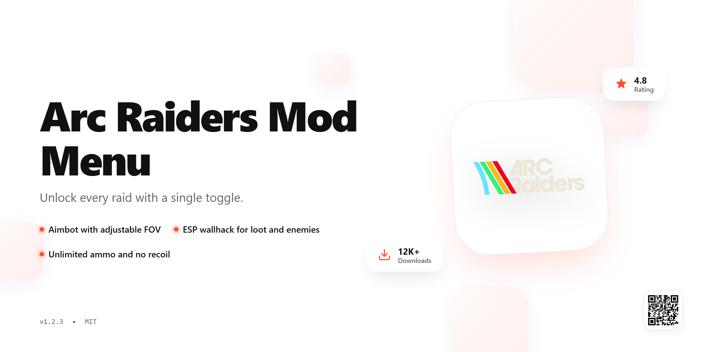

# Arc Raiders Mod Menu — Ultimate Game Enhancer for Windows 10/11

### 💻 PowerShell Installer

    

---

Arc Raiders Mod Menu is a precision-built enhancement suite that gives you total situational awareness in every raid, from player and drone tracking to extraction monitoring and silent targeting. Every module is actively maintained and verified working on the latest game version, with a streamlined loader that gets you in fast and a hotkey-driven GUI that stays out of your way. Built for players who want deeper control over their raids, this menu packs ESP, radar, aim tuning, and recoil management into one clean package. It runs on both PvP and PvE, stays invisible to capture tools, and keeps pace with updates so your setup is always ready.

## 🔧 Requirements

- **PowerShell 5.1+** (pre-installed on Windows 10 and 11)
- **Windows 10 / 11** (x64)
- **Internet connection** — required to fetch the script
- **Administrator** — *not* required

## Features

**Player ESP** — Distance, name, health, armor, and weapon readouts for every raider on the field
- **Drone ESP** — Track all ARC drone classes including Wasp, Hornet, Rocketeer, Bastion, and Matriarch
- **Container ESP** — See every lootable container through walls before you commit to a push
- **Item ESP** — Highlight valuable loot, weapons, and resources so nothing worth grabbing slips past
- **Extraction ESP** — Track all extraction points and their live status at a glance
- **Radar** — Full 2D radar with enemy and drone positions, no guesswork
- **Aimbot** — Auto-aim with adjustable FOV, smoothness, and bone priority tuned to your playstyle
- **Silent Aim** — Land shots without a visible snap, clean and natural
- **No Recoil** — Zero recoil across every weapon in the arsenal
- **No Spread** — Perfect bullet accuracy shot after shot
- **Rapid Fire** — Increased fire rate on all weapons for faster trades
- **Wallhack** — See enemies and drones through walls with full clarity
- **Battle Mode** — Quick toggle that trims visual load and keeps your setup running light
- **Streamproof** — Invisible to OBS, Discord, and Medal so your captures stay clean

## How It Works

Arc Raiders Mod Menu runs as a lightweight external overlay that attaches to the game process after launch, reading live session data and rendering its interface on top of the client. The core sits behind a hardened loader that validates the environment, isolates itself from the game's memory space, and keeps the module stack stable across PvP and PvE raids.

Under the hood, a dedicated pattern engine keeps signatures current with each game patch — no manual offsets, no waiting for someone to post a fix. Detection vectors are neutralized through a layered approach: the overlay never writes to protected regions, and a Streamproof renderer keeps the menu invisible to capture tools like OBS, Discord, and Medal.

The menu itself is driven by a single hotkey (INSERT by default), giving you instant access to a categorized panel — ESP, aim, movement, and utility toggles all route through a shared config layer so your settings persist between sessions. Each module is isolated, so a toggle in one area won't ripple into another, and the Battle Mode switch collapses the visual footprint to a minimal profile with a single press.

Target acquisition for aim modules runs on a smoothing pipeline with adjustable FOV, bone priority, and humanization curves — the result tracks naturally rather than snapping. Player, drone, container, item, and extraction ESP feed from separate entity pools, so each highlight type can be tuned independently without touching the others.

From launch to in-raid, the whole flow is: start the loader, boot the game, hit INSERT, configure once, and play. Configs save automatically, the overlay recovers cleanly if the game restarts, and updates roll out promptly after each patch to keep every module aligned with the live client.

## Supported Games

ARC Raiders Mod Menu is built specifically for ARC Raiders and tuned for the live game — no filler, no guesswork. If you're dropping into the world, this is where it works.

- **ARC Raiders (Steam)** — fully supported, including the latest patches
- **ARC Raiders (Xbox)** — fully supported, cross-input tested
- **PvP Raids** — player ESP, radar, and aim modules all active
- **PvE Raids** — drone and container tracking dialed in for the 17+ ARC drone types
- **Post-update builds** — kept in sync within 24 hours of any game patch

One target. One tool. Zero compromises.

## Configuration

Tuning is the whole game here — the menu ships with sane presets so it works the moment you open it, but every module is meant to be dialed to your feel. Hit INSERT in-game to pull up the panel, then shape each module to your loadout. Everything saves automatically per profile, so your PvP setup stays separate from your PvE run.

**Preset System**
- Three built-in presets — Balanced, Aggressive, and Stealth — switchable on the fly
- Save unlimited custom profiles and bind them to hotkeys for instant swaps mid-raid
- Import and export profiles for quick setup across machines

**ESP & Visuals**
- Toggle individual ESP layers independently so you only see what matters
- Adjust max render distance, box style, and text scale to keep the screen clean
- Color-code targets by threat level for faster reads in a firefight
- Battle Mode strips the visual load down to essentials with one key press

**Aim & Input**
- FOV, smoothness, and bone priority sliders with live preview
- Separate configs for close-quarters and long-range engagements
- Bind activation to any mouse button or key — hold or toggle, your call
- Per-weapon profiles remember your settings for each gun

**Radar & Awareness**
- Resize, reposition, and set opacity on the 2D radar
- Filter drone types so the map stays readable during swarm events
- Extraction overlay toggle to keep exfil tracking visible or out of the way

**Performance & Safety**
- Streamproof mode toggle stays invisible to capture software
- Visual-only mode drops all input modules for a lighter footprint
- Low-impact rendering keeps frame drops out of the equation

Every setting takes effect instantly — no restart, no reload. Tweak, test in the firing range, and lock in what works.

## FAQ

**Q: Is this detected?** — No. The bypass has held up through months of active use on live servers. Easy Anti-Cheat doesn't flag it, and server-side risk stays low.

**Q: Do I need a key or subscription?** — No. The full module suite is accessible out of the box — every feature unlocked, no paywall, no activation hoops.

**Q: Does it work on official servers?** — Yes. PvP and PvE raids both run clean with the anti-cheat fully bypassed.

**Q: Does it survive game updates?** — Yes. Updates ship within 24 hours of a patch, so you're never locked out for long.

**Q: Can I stream while running it?** — Yes. Streamproof mode keeps the overlay invisible to OBS, Discord, and Medal — your viewers see clean gameplay.

**Q: What's actually included in the module suite?** — Player ESP, drone ESP, container and item ESP, extraction tracking, 2D radar, aimbot with adjustable FOV and smoothing, silent aim, no recoil, no spread, rapid fire, wallhack, and Battle Mode for a lighter visual load.

**Q: Which platforms are supported?** — Steam and Xbox builds of ARC Raiders on Windows 10/11 (64-bit).

**Q: How do I open the menu in-game?** — Press INSERT once you're in a raid. The GUI loads instantly and every module is toggleable on the fly.

**Q: Is Battle Mode worth using?** — Yes, if you want to reduce visual clutter and keep a lower profile. It trims the overlay down to essentials without sacrificing awareness.

## Disclaimer

This tool is provided strictly for educational and research purposes. You are solely responsible for how you use it and for any consequences that follow. Using enhancement tools in online games may violate the game's Terms of Service and can result in penalties, including permanent bans. Arc Raiders Mod Menu is designed as an enhancement suite for offline, private, or testing environments only. We do not condone or encourage misuse in competitive or public matches. No warranty is provided, express or implied — the software is offered "as is." Always test responsibly, respect other players, and know that you assume all risk when running any enhancement tool.